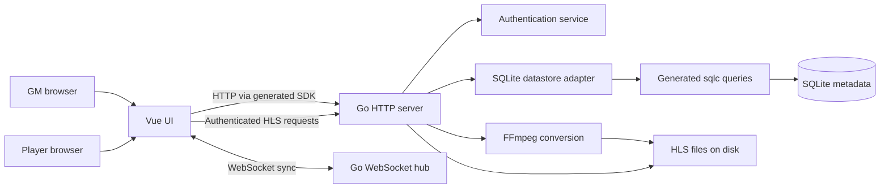

# Application architecture

RPG Audio Streamer (also labeled Skald Bot in the UI) is a single-table audio
library and synchronized listening app for tabletop games. A Game Master
uploads and controls audio. Players use an invite URL, opt in to listening,
and adjust their local volume mix. There is one configured GM account, one
static join token, and one shared library, not separate persisted game rooms.

## Runtime and boundaries

`main.go` composes configuration, logging, embedded migrations, the SQLite
adapter, authentication service, hub, and HTTP server. Startup applies pending
migrations before accepting requests. The CLI also exposes migration commands;
`cmd/hashpass` produces the Argon2id password hash used in configuration.

The Go server serves `/api/v1` routes; it does not serve the Vue application.
The Vue app is built and hosted separately. Vite development/preview uses an
API and WebSocket proxy (by default to `http://localhost:8080`); the proxy target
can be supplied through `API_PROXY_TARGET`. The browser SDK base URL comes from
`VITE_API_BASE_URL`, normally `/`.

## Backend

| Package | Responsibility |
| --- | --- |
| `internal/auth` | Argon2id credential checks, signed JWTs, GM/player roles, invite validation |
| `internal/server` | HTTP handlers, authentication cookies/middleware, track contracts, datastore and hub interfaces |
| `internal/middlewares` | API request logging and CORS |
| `internal/sqlitedatastore` | Domain-to-SQLite mapping, migrations, context-aware datastore implementation |
| `internal/sqlitedatastore/sqlitedb` | Generated sqlc models and query implementations |
| `internal/websocket` | Connected clients, message dispatch, recipient filters, read/write pumps |

There is not a separate Go domain package today. Authentication rules live
in `auth`; synchronization authorization/routing lives in `websocket`; the
track models and store interfaces live in `server`. The datastore implements
those interfaces, which keeps HTTP handlers independent of SQLite details.
`Server.Handler()` assembles the production HTTP pipeline independently of
binding a network listener. WebSocket upgrades bypass the API logging wrapper.

### Authentication and roles

GM login compares the configured username and Argon2id password hash, then
sets an HTTP-only `auth_token` cookie containing a signed JWT. Cookies are
secure outside development mode. Logout expires the cookie.

Players authenticate with the configured static invite token, not a GM cookie.
HTTP accepts that token as a bearer token; WebSockets use a `token` query
parameter because browser socket APIs cannot set Authorization headers.
Authentication resolves a cookie first, then the query token, then the bearer
token. The auth-status endpoint returns the authenticated state and role.

Only GMs can list, upload, update, and delete library entries or fetch the
invite token. Both roles can fetch track types, stream HLS files, and open
authenticated WebSockets.

### Library and persistence

SQLite stores metadata, not media bytes:

- `tracks`: UUID ID, creation timestamp, display name, disk path, track-type ID.
- `track_types`: UUID ID, name, color, repeat policy, simultaneous-play policy,
  and creation timestamp.

UUIDs are stored as BLOBs. Track creation timestamps are serialized as RFC3339
text, with second precision. Partial updates preserve omitted name/type fields.
The initial migration seeds Ambiance (repeating, simultaneous), Music
(repeating, exclusive), and One-Shot (non-repeating, simultaneous).
Empty metadata collections are returned as JSON arrays, not `null`.

An upload is multipart audio plus a display name and type UUID. The server
validates the type, assigns a UUIDv7, stages the input, and runs FFmpeg to
produce AAC HLS playlists and `.ts` segments under `<upload-dir>/<track-id>/`.
It then saves metadata. Streaming reads files from that upload directory.
Deletion removes metadata and the associated HLS directory. These filesystem
and database operations are not a single atomic transaction.

`sql/migrations` defines schema evolution; `sql/queries` is the authoritative
query source. `openapi.yaml` defines the HTTP client contract. Generated Go
queries and the TypeScript SDK are adapters, not handwritten business logic.

## Frontend

The Vue 3 application uses Vue Router, Vuetify, and Pinia. Routes are `/`
(landing), `/login` (GM credentials), `/join` (invite instructions), and
`/table/:token?` (GM or player session).

The table route resolves authentication before mounting a role-specific view.
The application shell checks authentication on non-table initial navigation;
table authentication is owned by the table view, not repeated in the player
view. This prevents competing status requests and logout-triggered player
reauthentication.

| Surface | Responsibility |
| --- | --- |
| `stores/auth.ts`, `stores/join.ts` | Session role, credentials, logout, invite retrieval |
| `stores/files.ts`, `stores/trackTypes.ts` | Library and track-type metadata through the generated SDK |
| `stores/audio.ts` | Per-file playback state, synchronization reconciliation, fades, master/type volumes |
| `stores/websocket.ts` | Socket connection/reconnection, message handlers and history |
| `stores/debug.ts` | Development-only debug panel state |
| `composables/` | Shared app-bar state, browser origin, immutable partial-object patches |
| `FileList`, `AudioControls`, `AudioUploader` | GM library, playback, metadata edits, and uploads |
| `AudioPlayer`, `AudioTrackPlayer` | Per-track HLS.js media elements and playback synchronization |
| `VolumeMixer`, `VolumeSlider` | Local master and per-type mixing |

Library, audio, and track-type stores use the Pinia persistence plugin; playback
state is keyed by file UUID, not display name. Local browser state is not
authoritative for stored library metadata. Players must explicitly connect
audio; full-state synchronization is ignored while listening is disabled.
Library entries initialize GM playback state as they load; successful deletion
also removes that state by UUID. The SDK's shared runtime configuration throws
on HTTP failures so store and upload error handlers cannot report false success.

GM track tiles show their track type as a colored border instead of a visible
badge, with a screen-reader label retaining the type name. A volume slider sits
above an interactive playback-position slider and elapsed/total time, flanked by
play/pause and restart buttons. Both sliders share compact track and thumb sizes
and aligned endpoints, with the volume icon centered above play/pause.
Seeking preserves the playing/paused state;
playing tracks synchronize the seek to listening players. Restart seeks to the
beginning. The metadata dialog retains the track-type selector.
A small top-left drag handle enables mouse or touch dragging via `@dnd-kit/vue`
after a 4 px movement. `SortableTrack` registers each grid cell and its handle.
The lifted card follows the pointer while a dashed insertion placeholder moves
between the other cards, which animate aside. Only the handle initiates dragging;
other card areas retain normal touch scrolling. Card clicks or Enter/Space toggle
playback, while the inline controls do not trigger card clicks. Focused cards or
handles can be reordered with Alt + Left/Right, with screen-reader announcements.
Cancelled drags restore the original layout without changing the saved order.
The file store persists this order in the GM's browser,
preserves it across metadata refreshes, appends newly discovered tracks, and drops
deleted tracks. Ordering does not change playback state or player mixes and is
not stored on the server or shared across devices.

### Playback synchronization

The server routes messages rather than storing authoritative playback state.
The GM browser owns current track state. On player connection, `syncRequest`
is forwarded to GM clients; a GM responds with `syncAll`, targeting the
requesting client. A full synchronization without a target goes to all players.
`syncTrack` carries incremental state from GMs to players. Players cannot issue
GM broadcasts, full-sync responses, or incremental sync commands.

The GM enforces track-type exclusivity in the UI: starting Music stops other
Music tracks, while Ambiance and One-Shot can overlap. GM master volume is
applied to outgoing synchronization. Each listener applies its own master
and per-type multipliers to incoming volume.

HLS.js binds authenticated playlists to hidden video elements. Track state
controls play/pause, seeking, looping, and volume. Repeating tracks fade over
approximately two seconds; significant seek differences are reconciled.
Removing a media component destroys its HLS instance and clears playback
timers; queued media events cannot recreate deleted track state.
Playback is ephemeral browser state, not persisted in SQLite or recovered by
the server after every GM disconnect.

## Architectural assurance

Domain tests exercise authentication, routing policies, and frontend state
transitions. SQLite integration tests use the real schema and adapter against
isolated file-backed databases. Browser journeys run the built Vue app with
the real Go server, database, FFmpeg, WebSockets, and HLS media playback.
These layers cover different boundaries rather than substituting mocks for
end-to-end behavior. Test execution and maintenance procedures live in the
repository testing skill.
