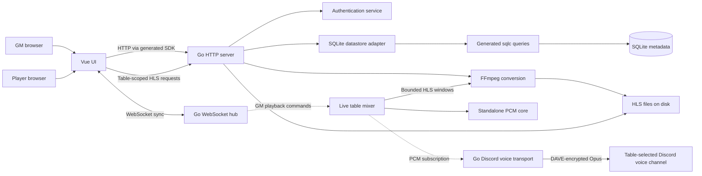

# Application architecture

RPG Audio Streamer (also labeled Skald Bot in the UI) is a multi-table audio
library and synchronized listening app for tabletop games. One configured Game
Master account manages named tables and a shared track library. Each table has
its own track associations and public table URL. Players see their table's
name, opt in to that table's playback, and adjust their local volume mix.

## Runtime and boundaries

`main.go` composes configuration, logging, embedded migrations, the SQLite
adapter, authentication service, hub, and HTTP server. Startup applies pending
migrations before accepting requests. The CLI also exposes migration commands;
`cmd/hashpass` produces the Argon2id password hash used in configuration.

The Go server serves API and WebSocket routes under `/api` and can serve the
built Vue application from `--frontend-dir` / `FRONTEND_DIR`. Non-API navigation
paths fall back to `index.html`; missing static files return 404. The Docker
image serves both on HTTP port 80 by default, with no built-in TLS; deploy a
TLS-terminating reverse proxy when HTTPS is needed. Vite development uses an
API and WebSocket proxy (by default to `http://localhost:8080`); the proxy target
can be supplied through `API_PROXY_TARGET`. The browser SDK base URL comes from
`VITE_API_BASE_URL`, normally `/`.

The optional API `--host` / `HOST` setting controls the listener interface;
its empty default preserves listening on all interfaces. The seeded local
development launcher (`scripts/dev.mjs`, exposed as `make dev`) binds both
the API and Vite to loopback on automatically selected ports. Each invocation
builds the real API into a unique temporary directory and creates a fresh
SQLite database, upload directory, and Vite cache. It uses public fixture GM
credentials, freshly salted native Argon2id password hashes, and per-instance
random signing keys. Nine generated audio fixtures (three per default
track type) use ordinary display names and are uploaded into the default table
through authenticated HTTP. Music fixtures use short original note sequences;
seeded ambiance noise gently swells over time so loop crossfades are audible.
Repeating fixtures remain 12 seconds long; one-shot tones retain their short
durations. This exercises normal validation, conversion, and persistence rather than writing
database fixtures directly. Vite uses the isolated API proxy and ignores
developer dotenv files; the API runs from the temporary directory with
explicit configuration. The launcher owns shutdown and removes its temporary
state on normal termination or startup failure. Discord is enabled in a seeded
preview only when explicitly requested through `DEV_DISCORD=1`; an allowlisted
loader reads its configuration from the worktree environment or `.env`, and
the API automatically enables the live mixer. Ordinary previews and browser
tests strip ambient Discord credentials before starting the API.
Uncatchable termination
cannot guarantee cleanup. Procedures live in the local-dev skill.

## Backend

| Package | Responsibility |
| --- | --- |
| `internal/auth` | Argon2id credential checks, signed JWTs, GM/player roles |
| `internal/server` | HTTP handlers, cookies/middleware, public table access, track/table contracts, datastore and hub interfaces |
| `internal/middlewares` | API request logging and CORS |
| `internal/mixer` | Standalone deterministic stereo PCM mixing, transport, loop overlap, and gain envelopes |
| `internal/livemixer` | Serialized live commands, table-scoped PCM engines, rendering lifecycle, and diagnostics |
| `internal/discord` | Bot discovery, table-bound voice connections, per-server reservations, Opus encoding, and DAVE transport |
| `ui/e2e` | Full-app browser journeys and Discord listener audio validation |
| `internal/sqlitedatastore` | Domain-to-SQLite mapping, migrations, context-aware datastore implementation |
| `internal/sqlitedatastore/sqlitedb` | Generated sqlc models and query implementations |
| `internal/websocket` | Authoritative live table playback, connected clients, message dispatch, recipient filters, read/write pumps |

Authentication rules live in `auth`; synchronization authorization/routing lives in `websocket`; the
track/table models and store interfaces live in `server`. The datastore implements
those interfaces, which keeps HTTP handlers independent of SQLite details.
`Server.Handler()` assembles the production HTTP pipeline independently of
binding a network listener. WebSocket upgrades bypass the API logging wrapper.

### Authentication and roles

GM login compares the configured username and Argon2id password hash, then
sets an HTTP-only `auth_token` cookie containing a signed JWT. Cookies are
secure outside development mode. Logout expires the cookie.

Each table has a database UUID and a separate, randomly generated Base64URL
external ID. Anyone with `/tables/<external-id>` can read that table's name
and associated tracks, stream those tracks, and connect to its WebSocket
without signing in or exchanging credentials. API stream URLs and WebSocket
connections carry the external ID; the server resolves it to the internal UUID
for table-scoped playback and track access. There is no player session, so each
tab can open a different table independently. A valid GM cookie on the same
URL selects the GM controls; it does not change the URL. GMs can rotate the
external ID; this invalidates the old URL and disconnects connected players.

Only GMs can create, rename, or delete tables, associate tracks, manage the
shared library, or change table settings. The auth-status endpoint reports GM
authentication only.

### Library and persistence

SQLite stores metadata, not media bytes:

- `tracks`: UUID ID, creation timestamp, display name, disk path, track-type ID,
  and shared playback-region points (beginning, optional end, optional loop-back).
- `track_types`: UUID ID, name, color, repeat policy, simultaneous-play policy,
  and creation timestamp.
- `game_tables`: UUID ID, unique random Base64URL external ID, name, and JSON GM
  mixing/ordering settings. The external ID is the public table identifier
  used in player URLs; the UUID remains the internal database identity.
- `table_tracks`: many-to-many table/track associations.

UUIDs are stored as BLOBs. Track creation timestamps are serialized as RFC3339
text, with second precision. Partial updates preserve omitted name/type fields.
The initial migration seeds Ambiance (repeating, simultaneous), Music
(repeating, exclusive), and One-Shot (non-repeating, simultaneous).
Empty metadata collections are returned as JSON arrays, not `null`.

Each table stores the GM's master volume, per-type volume map (keyed by type
name), per-track volume map (keyed by track UUID), and ordered track UUIDs.
The GM-only settings endpoint reads these preferences and accepts partial
patches: volume maps merge by key, the order is replaced, and omitted fields
are preserved atomically. Master volume accepts 0–200 percent; type and track
volumes accept 0–100 percent, including mute. Tables default to 100 percent
volume and creation-time track order. Playback position, play/pause state,
duration, and fades are not part of stored settings.

The table migration seeds "My Table" and associates all pre-existing tracks
with it. New tables start empty. Removing a track association or deleting a
table never deletes library audio. Deleting
a library track removes its associations everywhere. Cleanup triggers enforce
association removal even on SQLite connections without foreign keys enabled.

An upload is multipart audio plus a display name, type UUID, and optional table
UUID. The server validates the type, assigns a UUIDv7, stages the input, and runs FFmpeg to
produce AAC HLS playlists and `.ts` segments under `<upload-dir>/<track-id>/`.
It then saves metadata; table uploads save the library entry and association
in one database transaction. Streaming reads files from that upload directory.
After conversion the server also computes a 400-bucket peak waveform with
FFmpeg and caches it as `waveform.json` beside the playlist; a failure there only
logs a warning. The GM-only `GET /api/v1/files/{trackID}/waveform` endpoint
serves that cache, generating it on first request for older tracks.
Deletion removes metadata and the associated HLS directory. These filesystem
and database operations are not a single atomic transaction.

`sql/migrations` defines schema evolution; `sql/queries` is the authoritative
query source. `openapi.yaml` defines the HTTP client contract. Generated Go
queries and the TypeScript SDK are adapters, not handwritten business logic.

## Frontend

The Vue 3 application uses Vue Router, Vuetify, and Pinia. Routes are `/`
(landing), `/login` (GM credentials), `/join` (player invite-URL guidance),
`/tables` (GM table creation, renaming, and deletion), `/library` (shared
uploads and metadata management), and `/tables/:externalID` (the shared
GM/player table URL). GM login opens table management. Join as Player opens a
small information page explaining that players need the full
`/tables/:externalID` URL from their GM; it creates no player session. Table
views show associated tracks only; GMs can add an existing library track or
upload a new one directly into the table.
To preserve space during play, the table name appears only in the app bar.
Authenticated navigation lives in a left sidebar that is closed by default and
overlays the page when opened, with logout at the bottom. Logged-out visitors
see a login button in the app bar; player views show neither navigation nor login.
On GM tables, the master-volume control appears in the desktop now-playing
sidebar and the mobile now-playing drawer. **Add Track** and **Copy invite link**
appear at the top-right of the app bar on desktop and in its three-dot options
menu on smaller screens. **Rotate invite link** is always a red item in that
menu. Its confirmation dialog warns that active players will be disconnected
and the GM must reshare the new link; cancellation leaves the link unchanged.
After rotation, the GM's table URL updates to the new invite code.
On mobile layouts, the table options menu includes **Keep screen awake**.
This browser-local preference uses the Screen Wake Lock API while the app is
visible on a mobile layout, releases the lock when disabled or hidden, and
reacquires it when the app returns to the foreground. Unsupported browsers
show a disabled option, and denied requests produce an error notification.
It is independent of table settings and is not sent to the server or other clients.
Now-playing cards wrap into compact columns when space permits, including
inside the tablet bottom drawer; narrow phones retain a single column.
**Add Track** opens a dialog with library selection and new-upload tabs;
neither workflow adds a permanent control row to the track grid.
Uploads require a file, a nonblank name, and a valid library track type before
the Upload action is enabled.
Upload results appear as compact, auto-dismissing bottom-center toasts attached
to the document body, independent of the uploader's app-bar or library placement;
upload failures remain inline while the dialog is open.
The table-management list opens a table when its row is clicked. Each row's
three-dot menu copies the invite code and also contains rename, delete, and
red invite-link rotation actions. Rotation uses the same confirmation dialog
as the app bar.

The shared library uses a sortable, paginated metadata table showing each
track's name, type, and creation time. Row clicks (or keyboard
activation) toggle a local preview, with at most one preview playing at once.
Resuming a paused preview continues from its current position.
Library previews reuse the HLS player without opening a WebSocket or sending
synchronization messages. Resuming a preview retains its loaded duration and
playback region. Preview state is cleared on leaving the library;
it cannot become a table's playback state. Track editing is shared with the
table tiles through the audio-controls dialog's activator slot. Before deleting
a library track, the GM-only usage endpoint counts its current table
associations. When that count is nonzero, a separate follow-up dialog states
how many tables lose the track and must be confirmed; unused tracks delete
immediately. Deletion is blocked if the usage lookup fails. The deletion compares the confirmed count
atomically with the current associations; if it changed, the GM must check
usage again before deleting.
The audio-controls dialog combines seeking and playback-region editing on one
full-duration timeline, with a play/pause button to its left that uses the same
playback path as the track tile. When the dialog opens it fetches the track's
waveform once and draws it as the timeline bar: the played portion is bright, the
unplayed region dimmer, and trimmed areas grey. If the waveform cannot be loaded
the plain bar is shown instead. Beginning and end handles sit above the bar; repeating
types also have a repeat-icon loop-back handle below it. The selected type controls
its visibility without discarding saved loop-back points. Areas outside the
selected region are dimmed and cannot be
selected for seeking. Handles support mouse/touch dragging and keyboard adjustment.
Dragging a seek cursor previews its position and time without changing audio;
releasing commits one seek. Canceling a timeline seek discards the preview.
The released preview remains visible until the seek version acknowledges the command,
so intervening clock reports cannot flash the previous position.
Compact now-playing seek sliders also commit on release. Keyboard seeking and
restart controls commit immediately. Committed seeks during playback crossfade
the outgoing position into the destination over two seconds in both the browser
and Discord mixes. The selected time is the end of the incoming fade: a seek
from 10 to 20 seconds blends 10–12 with 18–20 and continues at 20. Seek targets
are capped two seconds before the playback-region end, leaving the final tail
for the natural loop crossfade. For regions shorter than two seconds, only the
beginning is seekable. A seek within the first two seconds of a region blends
in from its beginning and continues two seconds later. Fades shorten to the
available outgoing tail or region length. Paused seeks reposition silently.
The handles display their timestamps directly. Moving a boundary keeps the
loop-back point inside the region. The end defaults to the track duration;
moving the loop-back handle to the beginning reanchors it so it follows later
beginning adjustments. Moving the beginning to zero and the end to the full
duration restores the full track without separate reset controls. Point edits
update live playback on pointer release (including listening players at the current
table) and save to shared library metadata automatically. Name and region edits are
briefly debounced; type changes save immediately. Saves are serialized, and the
dialog reports failures with a retry action rather than discarding edits. Closing
waits for pending saves; invalid edits are not applied.
While dragging, marker labels and shading preview locally without changing audio
or sending region commands. Canceling discards that local preview; keyboard edits
commit immediately.
Region edits preserve each listener's live playhead without seeking to a reported
position. A playhead before the new beginning crossfades into that beginning;
a repeating playhead beyond the new end loops to the loop-back point.
An in-flight loop crossfade keeps its incoming source playing through marker edits,
preserving its position when valid and moving it into the edited region otherwise.
Seek crossfades preserve their gain progress when marker edits move the incoming
source, and a pending selection outside the edited region is cleared.
Shortening the end can complete that handoff early; extending it applies to the next
loop. A source that reaches its end without a prepared crossfade starts the next
loop from the configured loop-back point.
These settings are stored with the shared library track and apply in every table.
Opening library controls loads audio metadata without starting playback or
sending synchronization messages.

The table route checks for an optional GM cookie and loads by public external ID.
It mounts the GM controls for a logged-in GM and the player view otherwise.
Players need no session, so switching links or opening multiple table tabs
requires no authentication exchange.

| Surface | Responsibility |
| --- | --- |
| `stores/auth.ts` | GM session role, credentials, and logout |
| `stores/files.ts`, `stores/trackTypes.ts`, `stores/tables.ts` | Library, track-type, table, and association metadata through the generated SDK |
| `stores/audio.ts` | Per-file playback state, synchronization reconciliation, fades, master/type volumes |
| `stores/websocket.ts` | Socket connection/reconnection, message handlers and history |
| `stores/debug.ts` | Development-only debug panel state |
| `stores/clientPreferences.ts` | Browser-persisted screen-awake preference |
| `composables/` | Shared app-bar state, browser origin, immutable partial-object patches, screen wake-lock lifecycle |
| `FileList`, `AudioControls`, `PlayingTrackList`, `TrackPlaybackControls`, `TrackTimeline`, `AudioUploader` | Shared-library metadata management and uploads; table associations, responsive now-playing surfaces, and shared playback controls |
| `AudioPlayer`, `AudioTrackPlayer` | Per-track HLS.js media elements and playback synchronization |
| `VolumeMixer`, `VolumeSlider` | Active master and per-type mixing; player preferences stay local |

Library and track-type metadata and player mixer preferences use the Pinia
persistence plugin. GM mixes and track order load from the server before table
controls become available. They do not inherit browser-local mixer preferences.
Mix edits are debounced and flushed when leaving the table; saves are serialized
with ordering edits, and failures show an explicit retry action. Table metadata,
GM settings, and playback state are not persisted in browser storage.
Browser playback is keyed by file UUID within the active table and
cleared on table changes, so even the same library track cannot inherit another
table's playback. GM controls wait for the server's playback snapshot before
becoming available. Local browser state is not authoritative for stored metadata
or table playback.
Players must explicitly connect audio; full-state synchronization is ignored
while listening is disabled.
Associated entries initialize GM playback state as they load. Removing a table
association stops that track for the table; library deletion stops it in every
connected table. The SDK's shared runtime configuration throws on HTTP failures
so store and upload error handlers cannot report false success.

GM track tiles show their track type as a colored border instead of a visible
badge, with a screen-reader label retaining the type name. Cards stay compact
on hover, focus, and touch. Playing tiles have a saturated background mixed from
their track-type color; paused tiles retain the neutral surface. Tile names stay
on one line with ellipsis overflow and a full-name hover title.
A currently-playing sidebar lists active table tracks
with volume, playback-position, elapsed/total time, pause, and restart controls,
and provides master volume even when no tracks are playing.
The sidebar timer and seek bar's accessible value text measure elapsed time from
the configured beginning and total time to the configured end. Seeking still
uses absolute positions within the source audio.
Compact cards use a single-line name, tightly spaced controls, and a 260 px
desktop sidebar to preserve grid space. `PlayingTrackList` renders the same
cards in the sidebar and mobile drawer. The GM table fills the viewport width
without outer gutters or a centered maximum width. The desktop sidebar sits
flush against the right edge below the app bar, with a distinct surface,
left divider, full available viewport height, and independent scrolling.
The track grid uses the remaining width with 10 px of inner padding and 3 px
between cards; the sidebar remains flush against the right edge.
Truncated names retain their full
accessible label and hover title. On smaller screens, a fixed bottom bar shows
the playing-track count and opens a scrollable bottom drawer rather than taking
space above the grid. The drawer is capped at 70% of the viewport height and
supports closing with its button, Escape, or the backdrop; closing it does not
affect playback. The grid reserves space for the bar and device safe area.
Vuetify's `smAndDown` state controls both the sidebar/drawer selection and the
grid's mobile layout so they switch at the same breakpoint.
Paused, completed, removed, and type-exclusive displaced tracks leave the sidebar;
starting a track adds it automatically. Each card's always-visible three-dot
button opens a track-settings dialog with a volume slider aligned to the
timeline and a play/pause button, but no restart button.
`TrackPlaybackControls` supplies the compact sidebar controls; `TrackTimeline`
supplies the editor. Both use the same state and synchronization handlers.
Seeking preserves the playing/paused state; playing tracks synchronize volume
and seek changes to listening players. Sidebar restart seeks to the beginning.
Repeating tracks with a loop-back point distinct from the beginning show a small
orange tick on the compact seek bar. Anchored loop-back points have no tick.
Sidebar volume and seek bars use 6 px tracks and 18 px thumbs, matching the editor.
The editor's volume and seek bars share the same width, thickness, and thumb size, with
elapsed/total time centered vertically to the right of the seek bar. The metadata
dialog retains the track-type selector.
A small top-left drag handle enables mouse or touch dragging via `@dnd-kit/vue`
after a 4 px movement. `SortableTrack` registers each grid cell and its handle.
The lifted card follows the pointer while a dashed insertion placeholder moves
between the other cards, which animate aside. Only the handle initiates dragging;
other card areas retain normal touch scrolling. Card clicks or Enter/Space toggle
playback, while the inline controls do not trigger card clicks. Focused cards or
handles can be reordered with Alt + Left/Right, with screen-reader announcements.
Cancelled drags restore the original layout without changing the saved order.
The table store loads track order from server settings, scoped by table ID,
preserves it across metadata refreshes, appends newly discovered tracks, and
drops deleted tracks from the displayed order. Reordering saves to the server
so another GM browser restores the same layout. Ordering does not change
playback state or player mixes.

### Playback synchronization

The WebSocket hub owns authoritative live playback state in memory, keyed by
table and track UUID. Its datastore boundary reads track membership, library
metadata, track-type policies, and saved mixing settings through the existing
store interfaces.
Each connection has a server-validated table scope: the GM selects an existing
table by its external ID, while players supply that public external ID from the
URL. All routing filters,
including targeted full syncs and sync requests, also require a matching table.
Every GM and listening player requests a snapshot with `syncRequest` on
connection and reconnection. The server replies directly with `syncAll`,
including paused tracks and their positions; it does not need a connected GM.
GMs submit partial `syncTrack` commands for play/pause, seek, volume, duration,
and live playback-region edits. The server validates table membership and
regions, applies commands serially, and broadcasts canonical snapshots to both
roles, including the commanding GM. Omitted fields retain their current server
values rather than being replaced by a stale browser snapshot. Players cannot
change playback, and client-originated `syncAll` messages are not accepted.

Leaving a GM table disconnects that browser without changing table playback.
Deleting a table notifies and disconnects its active clients. Server-originated
`removeTrack` messages stop removed/deleted tracks for both roles. Socket
reconnects preserve table scope; leaving or switching tables cancels old retries
and ignores stale socket callbacks.

The server enforces track-type exclusivity atomically: starting Music stops other
Music tracks, while Ambiance and One-Shot can overlap. Snapshot positions advance
from server timestamps, accounting for repeating-region crossfade overlap and
one-shot completion without browser time-update messages. Browsers supply media
duration as metadata becomes available; the server does not decode audio.
Active tables receive a snapshot each second, keeping control-only browsers
and completion state current even when local audio cannot autoplay.
Explicit seek and play/pause commands advance a position version; only seeks also
advance a seek version. Running media
uses that version to distinguish commanded position changes from clock snapshots,
preserving local loop handoffs during live marker edits. While local media is
playing, same-version snapshots update other track fields without replacing its
displayed position. Control-only browsers continue to use snapshot positions.
Media pause, playback failure, and component disposal release local clock ownership.
The Discord mixer receives playback commands but does not send its render position
back to the browser.
The seek version distinguishes crossfade requests from play/pause commands and
periodic snapshots. Snapshots carry a `seekTarget` for the selection and a
`seekLanding` for the end of the fade; `currentTime` starts at the incoming
preroll and advances throughout the fade, keeping control-only views and new
listeners on that clock.
Consecutive keyboard seeks advance from the pending selection until the fade
lands; the target then clears so later keys follow the live playhead. A local
listener retains its pending target while its incoming media buffers.
Joining a table initializes directly at the snapshot's
position rather than replaying a previous seek transition.
GM snapshots carry unscaled track volume and saved table settings. Successful
settings patches update connected GM mixes and listener playback without
echoing remote changes back into another settings save. Player snapshots apply
the table master volume once; each listener then applies their own master and
per-type multipliers. Local autoplay failures do not pause the shared table.

HLS.js binds authenticated playlists to hidden media elements. Track state
controls play/pause, seeking, looping, and volume. Playback starts at the
configured beginning and stops or loops at the configured end. Repeating tracks
use a second HLS media element to crossfade over a global two-second interval
(shortened for shorter loop regions), starting the incoming source at the
loop-back point or configured beginning. Significant seek differences are
reconciled. Seek crossfades use the second HLS media element for repeating and
non-repeating tracks, keeping the outgoing source audible while the destination
loads. The displayed clock follows the destination during the overlap. Another
seek adopts the destination once its fade has begun, otherwise retaining the
audible outgoing source; pause adopts the incoming position, clears the pending
selection, and releases the tail.
Track, master, and type-volume changes ramp the mixed gain over two
seconds independently of play/pause fades and loop crossfades. A new adjustment
starts from the current interpolated gain, including mute and non-repeating
tracks. Removing a media component destroys its HLS instances and clears
playback timers; queued media events cannot recreate deleted track state.
Live playback survives every GM disconnect, table navigation, and browser
refresh for the lifetime of the server process. Reopening a table restores its
saved mix and layout together with the server's current playing/paused state
and positions. A server restart clears live playback; SQLite persists library
regions and table mixing/ordering settings, not the live playback clock.

### Standalone PCM mixer

`internal/mixer` is not part of the HTTP, WebSocket, or browser playback path.
It accepts normalized stereo PCM frames at one caller-selected sample rate.
`Add` copies an in-memory clip and leaves it paused; `AddSource` accepts a
bounded indexed source whose reads never block rendering.
`Play`, `Pause`, `Seek`, `CrossfadeSeek`, `SetRegion`, `SetRepeating`, `SetGain`, and `Remove`
control tracks; `State` exposes their absolute frame position and requested
playing state. `Render` overwrites a caller-owned output buffer and advances
the mix by that many frames. No device, codec, network connection, clock,
timer, or goroutine is created. One owner must serialize renders and controls.

Regions use absolute frame offsets with an exclusive end; initialization may land
exactly on the end, resolving completion or looping when playback renders.
A caller resolves an unset end to the decoded clip length
and an unset loop-back to the beginning before setting a region. Completion
stops non-repeating tracks and resets their position to the beginning.
Repeating tracks overlap the outgoing tail with an incoming cursor at the
loop-back point using complementary linear gains. The overlap length is
`min(2 * sampleRate, (end - loopBack) / 3, end - start)`, rounded down to
whole frames. The incoming cursor advances during the overlap and continues
from that position afterward, so an intro before the loop-back is not replayed.
Sub-frame overlaps become hard loops. `Seek` repositions directly for
initialization. `CrossfadeSeek` caps targets two seconds before the region end
(or at the beginning for shorter regions) and blends the current outgoing cursor
with preroll ending at the destination over up to two seconds. Targets in the
first two seconds start the incoming cursor at the region beginning. Fade duration
is limited by the outgoing tail and the region length.
`State` reports the advancing destination during seek overlap. A repeated seek
adopts the previous incoming cursor once the fade has begun. While destination
PCM is unavailable, the outgoing audio continues and the fade waits.
Natural loops warm their incoming PCM window two seconds before the overlap.
If that window is still decoding, outgoing audio continues while the overlap
shortens to the remaining tail instead of emitting silence.
Paused seeks reposition directly within the same seekable bounds.
Changing a region or repeat policy cancels overlap at the destination of a seek,
or at the outgoing position of a natural loop. A committed beginning beyond the
playhead crossfades into the beginning; a committed end before it resolves to
completion or the configured loop-back.

Repeating play/pause transitions use independent two-second linear envelopes.
Gain changes while fully silent apply directly, so the first audible frame uses
the configured volume rather than ramping down from full volume.
Pause cancels loop overlap, lets the outgoing cursor advance while fading,
then freezes it; reaching the region end during fade-out stops and resets it
rather than starting another loop. Non-repeating play/pause is immediate.
`SetGain` takes an effective track/master/type product in `[0, 1]` and ramps it
over two seconds while audible. Interrupted ramps start at the
current interpolated gain. Duplicate play/pause, gain, repeat, and region
settings do not restart ramps or loops.
Tracks are summed in insertion order and only the final stereo output is
saturated to `[-1, 1]`; there is no normalization or peak limiter.

Tests use small known PCM arrays and exact sample positions to assert audible
output, completion, crossfade boundaries, interruption, and silence. Rendering
the same command timeline with single, irregular, or whole buffers produces
the same samples and track state, including empty renders. File decoding,
source buffering, playback-state adapters, real-time scheduling, encoding,
and external audio delivery are outside this package.

### Discord live mixing

Discord streaming enables an `internal/livemixer` service inside the Go API
process. Browser HLS playback and player synchronization remain available
independently; the mixer supplies audio to Discord.

For an enabled service, the hub sends `mixerReady` to each authenticated GM
connection. The GM answers with `mixSync`: a full snapshot of playing tracks
and the current type-volume map. This happens on reconnect as well as initial
connection. Existing `syncTrack` messages feed partial play/pause, seek,
volume, repeating, and live playback-region changes into the mixer.
Seek commands use `CrossfadeSeek`; fresh snapshots initialize a paused engine
at the requested position before starting playback, without a seek transition.
Track volumes are unscaled; the supplied type-volume map includes the GM master
multiplier. The service applies that multiplier and caps effective gain at unity,
matching browser per-track gain clamping. The GM sends `mixVolumes` for live
type-volume and master-volume changes.
Play/resume commands include the GM's selected track volume, including unsaved
and zero values. The hub also supplies the resolved track volume and playback
region to the mixer on play, so clients omitting volume still honor saved settings.
When an exclusive track starts, the hub also sends pause commands for the
displaced tracks to the mixer. These commands use the core's playback envelopes
and are serialized with the accepted playback update, so Discord fades out
the previous Music track while simultaneous track types continue playing.
Frontend partial updates coalesce by track ID, preserving independent fields
and updates to different tracks in the same debounce window. Immediate
exclusivity and region changes flush queued commands first.

The hub derives table identity and GM authorization from the authenticated
socket, never the command payload. Targeted player `syncAll` responses do not
mutate the mixer; untargeted full syncs replace it, including the empty snapshot
on leaving a table. Mixer-only commands are ignored when disabled and never
forwarded to players. Successful commands receive `mixerAck`; failures receive
`mixerError` and are logged with table and command context. The GM displays
errors without stopping browser playback. A successful reconnect snapshot
clears the error. Normal player broadcasts happen before mixer processing,
so warming a decoder does not delay that broadcast.

`internal/server` supplies the PCM source. It checks the track's association
with the socket's table, loads track/type metadata through the datastore, and
uses HLS segment durations to determine the indexed PCM length. FFmpeg decodes
audio lazily in five-second windows at 48 kHz stereo float PCM. Each temporary
window playlist references only the stored HLS segments needed for that range,
so seeking does not decode the entire track from its beginning. The source
keeps a four-window least-recently-used cache, enough for both crossfading
cursors and their lookahead windows, and requests the next window
one second before playback reaches a boundary. This bounds PCM memory to
roughly 11 MiB of cached frames plus one in-flight decode window per active
track, regardless of track duration. Temporary manifests contain paths only
and are removed after decoding; decoded audio is not written to disk.
Each decode includes a 100 ms margin for AAC timestamp and frame rounding, then
clips or zero-pads to the indexed window length; larger shortfalls fail.
Crossfades and seeks access indexed windows, including loop-back windows.
Decoded samples are clamped to unity to accommodate AAC decoding overshoot.
FFmpeg failures are exposed on the corresponding live-mixer track status.
If a requested window is still decoding, that track temporarily renders
silence without advancing its playback cursor, so it resumes at the correct
audio rather than skipping frames.

Commands are serialized while a separate lock protects PCM rendering.
Validation precedes mutation, so invalid patches and snapshots do not
partially alter a mix. FFmpeg work runs asynchronously and source reads on the
render path are non-blocking.
The service renders 960-frame blocks every 20 ms with a cancellable loop.
It renders a table only while that table has a PCM subscriber, avoiding
duplicate decoding while Discord is disconnected.

Rendered PCM blocks are published to internal subscriptions for Discord
streaming. Subscribing does not start tracks or change their positions. Each
subscriber has a one-second buffer and is closed when it falls further behind
rather than delaying rendering. Closing the table session or stopping the
renderer closes its subscriptions. GM browser audio continues through
ordinary HLS playback; the server mix is audible through Discord.

Track disassociation removes the track from its table's mix; library deletion
removes it from all mixes. Table deletion and loss of its last GM connection
discard the session and cancel its decoder processes; in-flight source
preparation cannot recreate it. Multiple GMs share a table's mixer with
last-accepted-command semantics. Mixer state is ephemeral, not stored in SQLite.
Domain tests assert rendered samples after partial updates and snapshots,
table isolation, rejection without mutation, and nonblocking rendering/closure.
The full-app browser journey drives real GM controls and checks audio received
by a separate Discord bot.

### Optional Discord voice streaming

Set `DISCORD_STREAMING_ENABLED` and `DISCORD_STREAMING_BOT_TOKEN` to enable
Discord setup and the live mixer. When disabled, the UI hides Discord controls;
enabling it without a token fails startup.
The server uses its configured bot identity; the GM's existing app login
authorizes controls. This path does not link a Discord user account or use
OAuth client secrets. Voice transport runs in the Go API process.

Each table has a Discord control at the bottom of its desktop Currently playing
sidebar, or above the tracks in its mobile drawer. It shows a grey Connect button
when disconnected, a loading spinner while connecting, and a green Connected
button while streaming. Clicking Connected disconnects; hovering reveals the
destination server and voice channel. The button uses the Discord logo. Its setup dialog
loads `GET /api/v1/discord/setup`, which obtains the application ID and the
bot's installed servers from Discord. The server dropdown ends with an
`+ Add to server` option that opens Discord's authorization page with only bot
scope and View Channel, Connect, and Speak permissions. The user approves
installation in Discord, returns to the app, and refreshes the server list
using the adjacent refresh icon. No callback URL or OAuth client secret is
needed. The app's single configured GM account is authorized to select any
server that has installed this configured bot.

The dialog prompts for a server and a regular voice channel. The GM-only
`GET /api/v1/discord/servers/{guildID}/channels` endpoint lists channels.
`POST /api/v1/tables/{tableID}/discord` accepts the selected server/channel
IDs, verifies their association through Discord, connects, and saves the
destination and display names in that table's SQLite `discord_destination`
column. A failed save cancels the connection. An omitted request body
reconnects the saved destination. `GET` returns state and the saved
destination; `DELETE` disconnects only this table without forgetting it.
The composable prevents duplicate commands, discards stale status/channel
responses, and displays failures.

`internal/discord` reserves one voice connection per Discord server. Tables
can stream concurrently in different servers, but another table in the same
server receives a conflict and cannot take over the connection. Voice startup
does not hold the rendering lock;
the PCM subscription is created only once voice is ready, avoiding a full
subscriber queue during the handshake. The transport encodes 48 kHz stereo
PCM into Opus and sends it over Discord's DAVE-encrypted voice connection.
It reannounces the speaking source when participants join and periodically
so late listeners can associate incoming packets with the bot.
DAVE uses Discord's native libdave through the `godave/golibdave` Go bindings
in the server process; MLS itself is implemented by native libdave. The Linux image uses glibc and includes the pinned libdave shared
library and its licenses. Development and CI install the same verified upstream
release; a C compiler and pkg-config are needed to build.
The stream bot joins self-deafened and does not receive participants' audio.
Bot credentials are not passed in process arguments, browser payloads, or logs.

Disconnecting, closing the table mix, loss of its last GM, or renderer shutdown
ends the subscription and voice connection. Transport failures and slow PCM
consumers become observable error states. The first successful mixer sync of a
GM table session
follows an authoritative playback snapshot, so a reconnect sync includes the
table's active tracks before attempting the saved destination once. Repeated
syncs and status polling do not reconnect a manually disconnected bot. Leaving
a table or closing its last GM tab cancels pending reconnection and disconnects
the connection. Returning creates a new session and attempts reconnection.
Multiple GM tabs keep the bot active until the last one closes. A lost network connection is detected by the
WebSocket heartbeat. Reconnection conflicts and failures are visible and
require an explicit retry or destination change within that session.

The Playwright journey drives the
real UI and uses a separate Node listener bot with `@discordjs/voice` DAVE
decryption and Opus decoding. It measures the two generated tones and silence
after playback, volume, pause, disconnect, and reconnect controls. It verifies
delivery through Discord rather than trusting sender-side telemetry.
Voice receiving is not a stable, documented Discord API contract.

## Release pipeline

Pushes to `main` that match the release workflow's path filters run
semantic-release in dry-run mode to calculate a version and release notes from
conventional commits and existing tags. Only the commit analyzer and notes
generator are enabled; the workflow does not commit a changelog or push to
`main`. `gh release create` creates the version tag at the triggering commit
and publishes the generated notes on GitHub, respecting branch protection.
Release notes live in GitHub releases.

Release runs are serialized to avoid competing version calculations. When no
release is needed, publication and image building are skipped. After successful
publication, the shared `docker-build` workflow builds the Linux amd64 and
arm64 images natively on matching GitHub-hosted runners, pushes each by digest
to GHCR, and combines them into a multi-arch manifest tagged `latest`,
full-version, major.minor, and major. Each architecture keeps its own Buildx
GitHub Actions cache scope.

Pull requests that touch any image input run the same per-architecture builds
without pushing or publishing a manifest, and check that the Dockerfile's Go
and Node base images match `go.mod` and `ui/.nvmrc`, since dependency bumps do
not update the Dockerfile.

All pull requests run the Go tests, frontend domain tests, seeded development
tests, and full-app browser suite in `pr-checks`. The Go and browser suites
include live Discord validation in separate jobs for trusted same-repository
pull requests. Fork and Dependabot pull requests fail those credentialed checks
without access to repository secrets. A shared concurrency queue serializes
the jobs across runs.
`dorny/paths-filter` selects frontend lint/build and Docker checks for their
inputs. Pushes to main, scheduled runs, and manual dispatch also run live tests.
Changes to the workflow select every check; manual runs also execute every
check. The final `PR Checks` job depends on path detection and all check jobs,
accepts successful or skipped jobs, and fails on failed or cancelled jobs.
It provides a single required-check target, including for documentation-only
pull requests.

The separate Discord live workflow runs on pushes to `main`, nightly, and on
manual dispatch from `main`. One concurrency group serializes its Go and
Playwright tests across runs; pull request checks do not receive live secrets.

## Architectural assurance

Domain tests exercise authentication, routing policies, and frontend state
transitions. SQLite integration tests use the real schema and adapter against
isolated file-backed databases. Browser journeys run the built Vue app with
the real Go server, database, FFmpeg, WebSockets, and HLS media playback.
Each browser test attempt owns a separate server, datastore, upload directory,
and WebSocket state; the built UI and server executable are shared as immutable
artifacts. Live Discord validation uses a shared external voice channel.
These layers cover different boundaries rather than substituting mocks for
end-to-end behavior. Test execution and maintenance procedures live in the
repository testing skill.
