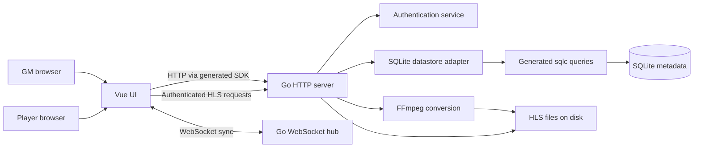

# Application architecture

RPG Audio Streamer (also labeled Skald Bot in the UI) is a multi-table audio
library and synchronized listening app for tabletop games. One configured Game
Master account manages named tables and a shared track library. Each table
has its own track associations and invite URL. Players see their table's name,
opt in to that table's playback, and adjust their local volume mix.

## Runtime and boundaries

`main.go` composes configuration, logging, embedded migrations, the SQLite
adapter, authentication service, hub, and HTTP server. Startup applies pending
migrations before accepting requests. The CLI also exposes migration commands;
`cmd/hashpass` produces the Argon2id password hash used in configuration.

The Go server serves `/api/v1` routes; it does not serve the Vue application.
The Vue app is built and hosted separately. Vite development/preview uses an
API and WebSocket proxy (by default to `http://localhost:8080`); the proxy target
can be supplied through `API_PROXY_TARGET`. The browser SDK base URL comes from
`VITE_API_BASE_URL`, normally `/`.

The optional API `--host` / `HOST` setting controls the listener interface;
its empty default preserves listening on all interfaces. The seeded local
development launcher (`scripts/dev.mjs`, exposed as `make dev`) binds both
the API and Vite to loopback on automatically selected ports. Each invocation
builds the real API into a unique temporary directory and creates a fresh
SQLite database, upload directory, and Vite cache. It uses public fixture GM
credentials, freshly salted native Argon2id password hashes, and per-instance
random signing/invite tokens. Nine generated audio fixtures (three per default
track type) use ordinary display names and are uploaded into the default table
through authenticated HTTP. Music fixtures use short original note sequences;
seeded ambiance noise gently swells over time so loop crossfades are audible.
Repeating fixtures remain 12 seconds long; one-shot tones retain their short
durations. This exercises normal validation, conversion, and persistence rather than writing
database fixtures directly. Vite uses the isolated API proxy and ignores
developer dotenv files; the API runs from the temporary directory with
explicit configuration. The launcher owns shutdown and removes its temporary
state on normal termination or startup failure. Uncatchable termination
cannot guarantee cleanup. Procedures live in the local-dev skill.

## Backend

| Package | Responsibility |
| --- | --- |
| `internal/auth` | Argon2id credential checks, signed JWTs, GM/player roles |
| `internal/server` | HTTP handlers, cookies/middleware, table invite resolution, track/table contracts, datastore and hub interfaces |
| `internal/middlewares` | API request logging and CORS |
| `internal/sqlitedatastore` | Domain-to-SQLite mapping, migrations, context-aware datastore implementation |
| `internal/sqlitedatastore/sqlitedb` | Generated sqlc models and query implementations |
| `internal/websocket` | Connected clients, message dispatch, recipient filters, read/write pumps |

There is not a separate Go domain package today. Authentication rules live
in `auth`; synchronization authorization/routing lives in `websocket`; the
track/table models and store interfaces live in `server`. The datastore implements
those interfaces, which keeps HTTP handlers independent of SQLite details.
`Server.Handler()` assembles the production HTTP pipeline independently of
binding a network listener. WebSocket upgrades bypass the API logging wrapper.

### Authentication and roles

GM login compares the configured username and Argon2id password hash, then
sets an HTTP-only `auth_token` cookie containing a signed JWT. Cookies are
secure outside development mode. Logout expires the cookie.

Players authenticate with a table-specific, randomly generated invite token,
not a GM cookie. The configured static invite token remains an alias for the
migrated default table; deleting that table invalidates the alias.
HTTP accepts that token as a bearer token; WebSockets use a `token` query
parameter because browser socket APIs cannot set Authorization headers.
Authentication resolves a cookie first, then the query token, then the bearer
token. Player authentication resolves the invite against SQLite on each request
and carries its table ID into streaming and WebSocket authorization. A GM
opening an invite URL retains their GM role but opens the invited table.
The auth-status endpoint returns the authenticated state and role.

Only GMs can manage tables, associate tracks, manage the shared library, or
retrieve invite tokens. Players can fetch their table's name, fetch track types,
stream HLS files associated with their table, and open authenticated WebSockets.
They cannot access other tables or list the library.

### Library and persistence

SQLite stores metadata, not media bytes:

- `tracks`: UUID ID, creation timestamp, display name, disk path, track-type ID,
  and shared playback-region points (beginning, optional end, optional loop-back).
- `track_types`: UUID ID, name, color, repeat policy, simultaneous-play policy,
  and creation timestamp.
- `game_tables`: UUID ID, name, unique invite token, and JSON GM mixing/ordering settings.
- `table_tracks`: many-to-many table/track associations.

UUIDs are stored as BLOBs. Track creation timestamps are serialized as RFC3339
text, with second precision. Partial updates preserve omitted name/type fields.
The initial migration seeds Ambiance (repeating, simultaneous), Music
(repeating, exclusive), and One-Shot (non-repeating, simultaneous).
Empty metadata collections are returned as JSON arrays, not `null`.

Each table stores the GM's master volume, per-type volume map (keyed by type
name), per-track volume map (keyed by track UUID), and ordered track UUIDs.
The GM-only settings endpoint reads these preferences and accepts partial
patches: volume maps merge by key, the order is replaced, and omitted fields
are preserved atomically. Master volume accepts 0–200 percent; type and track
volumes accept 0–100 percent, including mute. Tables default to 100 percent
volume and creation-time track order. Playback position, play/pause state,
duration, and fades are not part of stored settings.

The table migration seeds "My Table" and associates all pre-existing tracks
with it, preserving the existing invite URL. New tables start empty. Removing
a track association or deleting a table never deletes library audio. Deleting
a library track removes its associations everywhere. Cleanup triggers enforce
association removal even on SQLite connections without foreign keys enabled.

An upload is multipart audio plus a display name, type UUID, and optional table
UUID. The server validates the type, assigns a UUIDv7, stages the input, and runs FFmpeg to
produce AAC HLS playlists and `.ts` segments under `<upload-dir>/<track-id>/`.
It then saves metadata; table uploads save the library entry and association
in one database transaction. Streaming reads files from that upload directory.
After conversion the server also computes a 400-bucket peak waveform with
FFmpeg and caches it as `waveform.json` beside the playlist; a failure there only
logs a warning. The GM-only `GET /api/v1/files/{trackID}/waveform` endpoint
serves that cache, generating it on first request for older tracks.
Deletion removes metadata and the associated HLS directory. These filesystem
and database operations are not a single atomic transaction.

`sql/migrations` defines schema evolution; `sql/queries` is the authoritative
query source. `openapi.yaml` defines the HTTP client contract. Generated Go
queries and the TypeScript SDK are adapters, not handwritten business logic.

## Frontend

The Vue 3 application uses Vue Router, Vuetify, and Pinia. Routes are `/`
(landing), `/login` (GM credentials), `/join` (invite instructions), `/tables`
(GM table creation, renaming, and deletion), `/library` (shared uploads and
metadata management), `/tables/:tableID` (GM table), and `/table/:token?`
(invited table, or legacy default table for a GM without a token). Login opens
table management. Table views show associated tracks only; GMs can add an
existing library track or upload a new one directly into the table.
To preserve space during play, the table name appears only in the app bar.
Its **Add Track** action opens a dialog with library selection and new-upload
tabs; neither workflow adds a permanent control row to the track grid.
Uploads require a file, a nonblank name, and a valid library track type before
the Upload action is enabled.
Upload results appear as compact, auto-dismissing bottom-center toasts attached
to the document body, independent of the uploader's app-bar or library placement;
upload failures remain inline while the dialog is open.
The table-management list opens a table when its row is clicked; rename and
delete live in each row's three-dot menu.

The shared library uses a sortable, paginated metadata table showing each
track's name, type, and creation time. Row clicks (or keyboard
activation) toggle a local preview, with at most one preview playing at once.
Resuming a paused preview continues from its current position.
Library previews reuse the HLS player without opening a WebSocket or sending
synchronization messages. Preview state is cleared on leaving the library;
it cannot become a table's playback state. Track editing is shared with the
table tiles through the audio-controls dialog's activator slot. Before deleting
a library track, the GM-only usage endpoint counts its current table
associations. When that count is nonzero, a separate follow-up dialog states
how many tables lose the track and must be confirmed; unused tracks delete
immediately. Deletion is blocked if the usage lookup fails. The deletion compares the confirmed count
atomically with the current associations; if it changed, the GM must check
usage again before deleting.
The audio-controls dialog combines seeking and playback-region editing on one
full-duration timeline, with a play/pause button to its left that uses the same
playback path as the track tile. When the dialog opens it fetches the track's
waveform once and draws it as the timeline bar: the played portion is bright, the
unplayed region dimmer, and trimmed areas grey. If the waveform cannot be loaded
the plain bar is shown instead. Beginning and end handles sit above the bar; repeating
types also have a loop-back handle below it. The draft type selection controls
its visibility without discarding saved loop-back points. Areas outside the
selected region are dimmed and cannot be
selected for seeking. Handles support mouse/touch dragging and keyboard adjustment.
The handles display their timestamps directly. Moving a boundary keeps the
loop-back point inside the region. The end defaults to the track duration;
moving the loop-back handle to the beginning reanchors it so it follows later
beginning adjustments. Moving the beginning to zero and the end to the full
duration restores the full track without separate reset controls. Point edits
immediately update live playback (including listening players at the current
table), but shared library metadata is only persisted on Save. Closing without
saving restores the saved region in playback; invalid drafts are not applied.
These settings are stored with the shared library track and apply in every table.
Opening library controls loads audio metadata without starting playback or
sending synchronization messages.

The table route resolves authentication before mounting a role-specific view.
The application shell checks authentication on non-table initial navigation;
table authentication is owned by the table view, not repeated in the player
view. This prevents competing status requests and logout-triggered player
reauthentication.

| Surface | Responsibility |
| --- | --- |
| `stores/auth.ts`, `stores/join.ts` | Session role, credentials, logout, invite retrieval |
| `stores/files.ts`, `stores/trackTypes.ts`, `stores/tables.ts` | Library, track-type, table, and association metadata through the generated SDK |
| `stores/audio.ts` | Per-file playback state, synchronization reconciliation, fades, master/type volumes |
| `stores/websocket.ts` | Socket connection/reconnection, message handlers and history |
| `stores/debug.ts` | Development-only debug panel state |
| `composables/` | Shared app-bar state, browser origin, immutable partial-object patches |
| `FileList`, `AudioControls`, `PlayingTrackList`, `TrackPlaybackControls`, `TrackTimeline`, `AudioUploader` | Shared-library metadata management and uploads; table associations, responsive now-playing surfaces, and shared playback controls |
| `AudioPlayer`, `AudioTrackPlayer` | Per-track HLS.js media elements and playback synchronization |
| `VolumeMixer`, `VolumeSlider` | Active master and per-type mixing; player preferences stay local |

Library and track-type metadata and player mixer preferences use the Pinia
persistence plugin. GM mixes and track order load from the server before table
controls become available. They do not inherit browser-local mixer preferences.
Mix edits are debounced and flushed when leaving the table; saves are serialized
with ordering edits, and failures show an explicit retry action. Table metadata,
GM settings, and playback state are not persisted in browser storage.
Playback is keyed by file UUID within the active table and
cleared on table changes, so even the same library track cannot inherit another
table's playback. Local browser state is not authoritative for stored metadata.
Players must explicitly connect audio; full-state synchronization is ignored
while listening is disabled.
Associated entries initialize GM playback state as they load. Removing a table
association stops that track for the table; library deletion stops it in every
connected table. The SDK's shared runtime configuration throws on HTTP failures
so store and upload error handlers cannot report false success.

GM track tiles show their track type as a colored border instead of a visible
badge, with a screen-reader label retaining the type name. Cards stay compact
on hover, focus, and touch. Playing tiles have a saturated background mixed from
their track-type color; paused tiles retain the neutral surface. Tile names stay
on one line with ellipsis overflow and a full-name hover title.
A currently-playing sidebar lists active table tracks
with volume, playback-position, elapsed/total time, pause, and restart controls.
The sidebar timer and seek bar's accessible value text measure elapsed time from
the configured beginning and total time to the configured end. Seeking still
uses absolute positions within the source audio.
Compact cards use a single-line name, tightly spaced controls, and a 260 px
desktop sidebar to preserve grid space. `PlayingTrackList` renders the same
cards in the sidebar and mobile drawer. The GM table fills the viewport width
without outer gutters or a centered maximum width. The desktop sidebar sits
flush against the right edge below the app bar, with a distinct surface,
left divider, full available viewport height, and independent scrolling.
The track grid uses the remaining width with 10 px of inner padding and 3 px
between cards; the sidebar remains flush against the right edge.
Truncated names retain their full
accessible label and hover title. On smaller screens, a fixed bottom bar shows
the playing-track count and opens a scrollable bottom drawer rather than taking
space above the grid. The drawer is capped at 70% of the viewport height and
supports closing with its button, Escape, or the backdrop; closing it does not
affect playback. The grid reserves space for the bar and device safe area.
Vuetify's `smAndDown` state controls both the sidebar/drawer selection and the
grid's mobile layout so they switch at the same breakpoint.
Paused, completed, removed, and type-exclusive displaced tracks leave the sidebar;
starting a track adds it automatically. Each card's always-visible three-dot
button opens a track-settings dialog with a volume slider aligned to the
timeline and a play/pause button, but no restart button.
`TrackPlaybackControls` supplies the compact sidebar controls; `TrackTimeline`
supplies the editor. Both use the same state and synchronization handlers.
Seeking preserves the playing/paused state; playing tracks synchronize volume
and seek changes to listening players. Sidebar restart seeks to the beginning.
Repeating tracks with a loop-back point distinct from the beginning show a small
orange tick on the compact seek bar. Anchored loop-back points have no tick.
Sidebar volume and seek bars use 6 px tracks and 18 px thumbs, matching the editor.
The editor's volume and seek bars share the same width, thickness, and thumb size, with
elapsed/total time centered vertically to the right of the seek bar. The metadata
dialog retains the track-type selector.
A small top-left drag handle enables mouse or touch dragging via `@dnd-kit/vue`
after a 4 px movement. `SortableTrack` registers each grid cell and its handle.
The lifted card follows the pointer while a dashed insertion placeholder moves
between the other cards, which animate aside. Only the handle initiates dragging;
other card areas retain normal touch scrolling. Card clicks or Enter/Space toggle
playback, while the inline controls do not trigger card clicks. Focused cards or
handles can be reordered with Alt + Left/Right, with screen-reader announcements.
Cancelled drags restore the original layout without changing the saved order.
The table store loads track order from server settings, scoped by table ID,
preserves it across metadata refreshes, appends newly discovered tracks, and
drops deleted tracks from the displayed order. Reordering saves to the server
so another GM browser restores the same layout. Ordering does not change
playback state or player mixes.

### Playback synchronization

The server routes messages rather than storing authoritative playback state.
Each connection has a server-validated table scope: the GM selects an existing
table ID, while players inherit the table from their invite. All routing filters,
including targeted full syncs and sync requests, also require a matching table.
The GM browser owns current track state. On player connection, `syncRequest`
is forwarded to GM clients; a GM responds with `syncAll`, targeting the
requesting client. A full synchronization without a target goes to all players
at that table.
`syncTrack` carries incremental state from GMs to players. Players cannot issue
GM broadcasts, full-sync responses, or incremental sync commands.

Leaving a GM table sends an empty full sync to its players before disconnecting.
Deleting a table notifies and disconnects its active clients. Server-originated
`removeTrack` messages stop removed/deleted tracks for both roles. Socket
reconnects preserve table scope; leaving or switching tables cancels old retries
and ignores stale socket callbacks.

The GM enforces track-type exclusivity in the UI: starting Music stops other
Music tracks, while Ambiance and One-Shot can overlap. GM master volume is
applied to outgoing synchronization. Each listener applies its own master
and per-type multipliers to incoming volume.

HLS.js binds authenticated playlists to hidden media elements. Track state
controls play/pause, seeking, looping, and volume. Playback starts at the
configured beginning and stops or loops at the configured end. Repeating tracks
use a second HLS media element to crossfade over a global two-second interval
(shortened for shorter loop regions), starting the incoming source at the
loop-back point or configured beginning. Significant seek differences are
reconciled. Track, master, and type-volume changes ramp the mixed gain over two
seconds independently of play/pause fades and loop crossfades. A new adjustment
starts from the current interpolated gain, including mute and non-repeating
tracks. Removing a media component destroys its HLS instances and clears
playback timers; queued media events cannot recreate deleted track state.
Playback is ephemeral browser state, not persisted in SQLite or recovered by
the server after every GM disconnect. Opening a table restores its saved mix
and layout with every track stopped at the beginning.

## Release pipeline

Pushes to `main` that match the release workflow's path filters run
semantic-release in dry-run mode to calculate a version and release notes from
conventional commits and existing tags. Only the commit analyzer and notes
generator are enabled; the workflow does not commit a changelog or push to
`main`. `gh release create` creates the version tag at the triggering commit
and publishes the generated notes on GitHub, respecting branch protection.
Release notes live in GitHub releases.

Release runs are serialized to avoid competing version calculations. When no
release is needed, publication and image building are skipped. After successful
publication, the Docker job builds Linux amd64/arm64 images and pushes `latest`,
full-version, major, and major.minor tags to GHCR.

Pull requests that touch any image input build the same multi-arch image and
check that the Dockerfile's Go and Node base images match `go.mod` and
`ui/.nvmrc`, since dependency bumps do not update the Dockerfile.

All pull requests run the `pr-checks` workflow. `dorny/paths-filter` selects Go
tests for backend inputs, frontend lint/build/domain checks for UI, development
scripts, or OpenAPI inputs, full-app browser and seeded development instance
tests for either, and Docker checks for image inputs.
Changes to the workflow select every check; manual runs also execute every
check. The final `PR Checks` job depends on path detection and all check jobs,
accepts successful or skipped jobs, and fails on failed or cancelled jobs.
It provides a single required-check target, including for documentation-only
pull requests.

## Architectural assurance

Domain tests exercise authentication, routing policies, and frontend state
transitions. SQLite integration tests use the real schema and adapter against
isolated file-backed databases. Browser journeys run the built Vue app with
the real Go server, database, FFmpeg, WebSockets, and HLS media playback.
These layers cover different boundaries rather than substituting mocks for
end-to-end behavior. Test execution and maintenance procedures live in the
repository testing skill.
