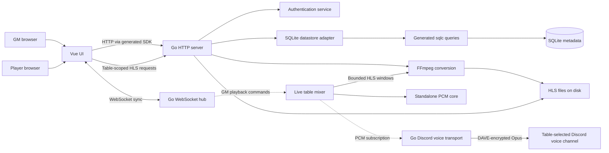

# Application overview

RPG Audio Streamer (also labeled Skald Bot in the UI) is a multi-table audio
library and synchronized listening app for tabletop games. One configured Game
Master account manages named tables and a shared track library. Each table has
its own track associations and [public table URL](./backend/public-table-links.md).
Players see their table's name, opt in to that table's playback, and adjust
their local volume mix.

## Runtime and boundaries

- The [process composition](./runtime/composition.md) wires these pieces
  together, and the [HTTP server](./runtime/http-serving.md) exposes the API,
  WebSocket, and built UI.
- The [Go packages](./backend/packages.md) separate authentication, HTTP
  handling, persistence, synchronization, and audio mixing.
- [SQLite](./data/sqlite-schema.md) stores metadata; [uploaded tracks](./data/track-uploads.md)
  live on disk as HLS.
- The [WebSocket hub](./playback/synchronization.md) owns live table playback.
- The optional [live mixer](./discord/live-mixer.md) streams a table's mix to
  [Discord voice](./discord/voice-streaming.md).
